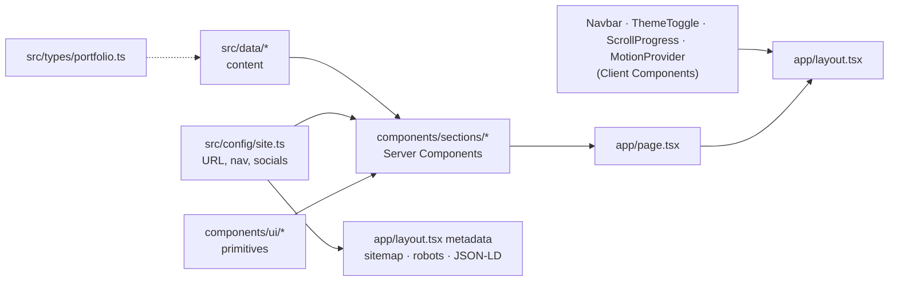

# Architecture

## Overview

The portfolio is a single statically prerendered page (`/`) plus generated metadata routes. Content, configuration, and UI are kept separate:

## Folder responsibilities

| Path                        | Responsibility                                                                                                    |
| --------------------------- | ----------------------------------------------------------------------------------------------------------------- |
| `src/app`                   | Root layout (fonts, metadata, theme script), the home page, `not-found`, `sitemap`, `robots`, OG image, icons     |
| `src/components/sections`   | One component per page section, plus section-specific parts (`ProjectCard`, `ArchitectureFlow`, `HeroCodeWindow`) |
| `src/components/ui`         | Generic primitives reused across sections                                                                         |
| `src/components/navigation` | Header navigation and theme toggle (client)                                                                       |
| `src/components/layout`     | Footer and JSON-LD injection                                                                                      |
| `src/components/animations` | `MotionProvider`, `Reveal`, `CountUp` (client, built on `motion`)                                                 |
| `src/config`                | Site-wide configuration: URL resolution, SEO defaults, nav items, social links, resume path                       |
| `src/data`                  | All portfolio content, typed by `src/types/portfolio.ts`                                                          |
| `src/hooks`                 | Client hooks (`useActiveSection`)                                                                                 |
| `src/lib`                   | Pure helpers (`cn`, `cssVars`) and the JSON-LD builder                                                            |

## Rendering model

- **Server Components by default.** Every section renders on the server; only small client "islands" ship JavaScript.
- **Client Components:**
  - `Navbar` handles the scroll state, mobile menu, and active-section highlighting; `ScrollProgress` draws the reading-progress bar.
  - `ThemeToggle` flips `data-theme` on `<html>` and saves the choice to `localStorage`.
  - `MotionProvider` (in the root layout) sets up `LazyMotion` with `domAnimation` and `MotionConfig reducedMotion="user"`.
  - `Reveal` wraps server-rendered markup in an `m.*` element that fades/slides in on scroll; `CountUp` animates stat numbers when they enter the viewport.
- **Skeleton loading:** `src/app/loading.tsx` renders a shimmer skeleton of the home layout while a route streams (e.g. client navigation). The profile photo sits on a shimmer placeholder until it loads. The home page itself is prerendered, so first loads don't wait on data.
- **Cache Components** (`cacheComponents: true` in `next.config.ts`) is enabled. The page is fully static. The footer's copyright year uses `"use cache"` with `cacheLife("max")`, which keeps the page static and revalidates it at most every 30 days.

## Theming

- Design tokens are CSS variables in `src/app/globals.css`, defined for `:root` (light) and `[data-theme="dark"]`, and exposed to Tailwind via `@theme inline` (`bg-bg`, `bg-surface`, `text-fg`, `text-muted`, `border-line`, `text-accent`, …).
- The `dark:` variant is bound to `[data-theme="dark"]`.
- An inline script in `<head>` runs before paint and applies the saved theme, falling back to the system preference.
- `ThemeToggle` picks its icon with CSS (`dark:block` / `dark:hidden`), so server and client markup always match.

## Motion

- JavaScript animations use [`motion`](https://motion.dev) (the maintained successor to Framer Motion). `react-reveal` was not used because it only supports React 15–16.
- `LazyMotion` + `m.*` keeps the motion bundle small; `MotionConfig reducedMotion="user"` disables transform animations for users who prefer reduced motion.
- CSS-only motion (hero fade-up, floating badges, blobs, marquee, skeleton shimmer) sits inside `@media (prefers-reduced-motion: no-preference)`.
- Stat counters render the final value for screen readers (`sr-only`) and animate a visual copy.
- The hero `h1` is never animated, which protects LCP.

## Design direction

The site takes inspiration from a modern "systems engineer" aesthetic: a dark canvas, a subtle grid, cyan/violet accents, mono labels, and architecture-style diagrams. It is an original design built around this portfolio's own content.
